# Fieldnote Popup Studio

Fieldnote helps independent businesses turn their existing website content into an email signup popup. An owner analyzes a site, reviews three JSON-configured popup concepts, edits one, and publishes it as a small embeddable script. Published campaigns collect consented email signups and events; the dashboard compares variants while accounting for uncertainty and sample size.

## Project Status

The application is a working portfolio project, not a deployed production service. Local frontend builds and the backend test suite have been run. Docker is not installed in the current development environment, so the complete Compose stack has not been run here. There is no live URL or recorded demo video yet.

Dashboard, editor, and widget screenshots have not been captured from a running full stack. Add verified captures under `docs/screenshots/` after running the application; do not use generated mock screenshots as evidence of working backend behavior.

## Architecture

```mermaid
flowchart LR
    Owner[Business owner] --> Scraper[SSRF-protected site fetch and extraction]
    Scraper --> Analysis[Gemini website analysis as validated JSON]
    Analysis --> Generator[Gemini popup generation as validated JSON]
    Generator --> Editor[React editor and live preview]
    Editor --> Publish[Publish selected version]
    Publish --> Widget[Vanilla JS widget in Shadow DOM]
    Widget --> Events[Impression, dismissal, and signup events]
    Events --> Stats[Beta-Binomial comparison and recommendation]
    Stats --> Editor
```



## Stack

| Area | Technology | Reason |
|---|---|---|
| API | Python 3.12, FastAPI 0.162.5, Pydantic 2 | Typed request validation and generated API docs |
| Data | PostgreSQL 16, SQLAlchemy 2.0.48, Alembic 1.14.1 | Relational ownership and event/subscriber aggregation |
| Website fetch | HTTPX 0.28.1, BeautifulSoup 4.15.0, Pillow 13.0.0 | Bounded static fetch, structured extraction, and logo colors |
| JavaScript-rendered fetch | Playwright 1.65.0 | Planned fallback; intentionally disabled until sandboxed pinned networking is available |
| AI | Gemini API, model selected by `GEMINI_MODEL` | Structured JSON generation without an agent framework |
| Dashboard | React 19.3.1, Vite 8.3.8, Tailwind CSS 4.3.5 | Stateful editor and fast static frontend build |
| Embedded widget | Vanilla JavaScript | Small dependency-free script for customer sites |
| Deployment | Docker Compose, Nginx 1.27, PostgreSQL 16 | Reproducible local services and same-origin dashboard proxy |

## Screenshots

Screenshots are not included yet because the complete container stack could not be run in the current environment. After starting the application, capture and add:

- `docs/screenshots/dashboard.png`: analyze-site dashboard after sign-in
- `docs/screenshots/editor.png`: generated variants, editor, and preview
- `docs/screenshots/popup.png`: widget rendered on the host test page

## Example Website Analysis

Illustrative schema-shaped response; values below are examples, not analysis results from a live site:

```json
{
  "business_type": "Outdoor apparel store",
  "target_audience": "People looking for durable everyday outdoor clothing",
  "brand_tone": "Practical and welcoming",
  "products": ["Jackets", "Shirts"],
  "brand_colors": ["#174A38", "#B15A34"],
  "suggested_offer": {
    "text": "Explore the new collection",
    "requires_owner_approval": true
  }
}
```

## Example Popup Configuration

Illustrative config accepted by the editor and widget:

```json
{
  "headline": "A warmer welcome",
  "description": "Thoughtful layers for your next everyday adventure.",
  "cta": "Join the list",
  "email_placeholder": "Your email address",
  "offer": {
    "text": "Explore the new collection",
    "requires_owner_approval": true
  },
  "layout": "centered",
  "trigger": {
    "type": "time_delay",
    "delay_seconds": 7,
    "scroll_percentage": 50
  },
  "theme": {
    "background_color": "#FFFFFF",
    "text_color": "#174A38",
    "accent_color": "#B15A34",
    "font": "georgia",
    "border_radius": 10
  },
  "image": null,
  "consent_text": "By subscribing, you agree to receive email updates."
}
```

## Install and Run

Prerequisites: Python 3.12, Node.js 24 (or a Vite-compatible supported Node release), and Docker Compose v2.

1. Copy `.env.example` to `.env`.
2. Set a local PostgreSQL password and a long random `JWT_SECRET_KEY`. For example, generate a key with `python -c "import secrets; print(secrets.token_urlsafe(48))"` and paste it into `.env` yourself.
3. Set `GEMINI_API_KEY` and `GEMINI_MODEL` to use analysis and generation. These credentials are optional for running the services, but those AI actions require them.
4. Start the stack from the repository root:

```powershell
docker compose up --build
```

The frontend is at `http://localhost:5173`, the API at `http://localhost:8000`, and FastAPI docs at `http://localhost:8000/docs`. Alembic migrations run when the API container starts. The host-page fixture is available at `http://localhost:5173/widget-test.html`; it requires a published campaign whose allowed origin matches the fixture origin to load a popup.

## Verification

The latest local checks completed 64 backend unit tests, Python compilation, the frontend production build, `npm audit --audit-level=high` (zero reported vulnerabilities), and `pip-audit -r backend/requirements.txt` (no known vulnerabilities). The Docker Compose stack itself has not been run because Docker is unavailable in the current environment.

For frontend-only work without Docker, install and start Vite from `frontend/`:

```powershell
npm ci
npm run dev
```

For backend tests from the repository root with the project virtual environment:

```powershell
$env:PYTHONPATH = "backend"
$env:DATABASE_URL = "sqlite+pysqlite:///:memory:"
$env:JWT_SECRET_KEY = "local-test-only-secret"
.\.venv\Scripts\python.exe -m unittest discover -s backend\tests -v
```

## API Overview

Interactive API reference: `http://localhost:8000/docs`.

- `POST /api/auth/register`, `POST /api/auth/login`: create an account and obtain an expiring bearer token.
- `POST /api/websites/analyze`: fetch and analyze an owner-supplied website.
- `POST /api/popups/generate`: generate three schema-validated variants.
- `POST /api/popups/campaigns`, `PATCH /api/popups/versions/{id}`: save drafts and edits.
- `POST /api/popups/versions/{id}/regenerate`: request a constrained patch to editable fields.
- `POST /api/popups/campaigns/{id}/publish`, `POST /api/popups/campaigns/{id}/default`: publish or select a default and stop variant rotation.
- `GET /api/public/campaigns/{id}/config/{visitor_id}`: return a stable visitor-assigned published config.
- `POST /api/public/campaigns/{id}/events`, `POST /api/public/campaigns/{id}/subscribe`: widget events and signup collection.
- `GET /api/popups/campaigns/{id}/analytics`: owner-only campaign and per-version metrics/recommendation.
- `GET /api/popups/campaigns/{id}/subscribers.csv`, `DELETE /api/popups/campaigns/{id}/subscribers/{subscriber_id}`: owner-only export and deletion.

## Optimization Method

Each version is modeled as a Beta-Binomial conversion rate with a uniform Beta(1,1) prior. The service uses deterministic-seeded Monte Carlo samples to estimate each version's probability of being best, a 90% credible interval, and expected lift against the current default. A winner is returned only after every version reaches 100 impressions and the top probability is at least 95%. Until both gates are met, the response says “not enough data” or “no clear winner.” Dismissals are reported separately and are not called site bounce rate.

Visitor assignment hashes the campaign and anonymous visitor ID, then selects a stable version bucket. Choosing “Make default” turns off rotation and serves the selected version to future visitors.

Synthetic demo events can be inserted with explicit counts. From `backend/`, after configuring database environment variables and applying migrations:

```powershell
python -m app.scripts.seed_analytics <campaign-uuid> --impressions 200 --submissions-per-version 6,22,10
```

The generated subscriber emails use the reserved `.invalid` domain. Seeded values are demo data and must not be reported as observed campaign results.

## Security and Privacy

- The analyzer accepts only HTTP(S), blocks non-public IP ranges, pins connections to validated addresses, revalidates redirects, and enforces time/size/content-type limits.
- Playwright fallback remains disabled. Enabling it requires a sandboxed browser runtime and a network path that preserves the validated-IP guarantee.
- Gemini receives scraped content as untrusted text and returns schema-constrained JSON. The app renders config values itself; the model never returns executable HTML or JavaScript.
- The widget uses a closed Shadow DOM, DOM text APIs, and fixed font/layout/trigger allowlists. It does not render config through `innerHTML`.
- Public routes validate campaign/version pairing, enforce campaign-origin CORS, constrain payload fields and size, and apply per-process rate limits.
- Passwords use Argon2; JWT signing and Gemini credentials come from environment configuration.
- The widget stores a random anonymous visitor ID, frequency-cap timestamp, and signup-suppression flag in local storage when available. It does not fingerprint visitors.
- Signup consent wording and timestamp are stored with the subscriber. Owners can export or delete subscriber records.
- Public event rate limits are currently in process memory; production multi-instance deployments need shared rate-limit storage.

## Demo Walkthrough

See [`docs/demo-script.md`](docs/demo-script.md) for a concise recording outline. A hosted demo and deployment link have not been created yet.

## Known Limitations and Next Steps

- No production deployment, hosted demo URL, screenshots, or recorded walkthrough has been created yet.
- No password recovery, billing, production-grade account controls, or broad browser matrix.
- JavaScript-rendered website extraction remains disabled pending sandboxed, IP-pinned browser networking.
- Rate limiting is process-local and needs a shared store for multiple API replicas.
- Public CORS is tied to the analyzed website's origin; production domain changes need a corresponding ownership-verified update workflow.
- The signup event table is optimized for the project demo. High-volume analytics would need aggregation, retention policy, and abuse monitoring.
- Next steps: run and smoke-test the complete Compose stack on a Docker-enabled host, capture real dashboard/editor/widget screenshots, deploy to a chosen host, and record the demo script.